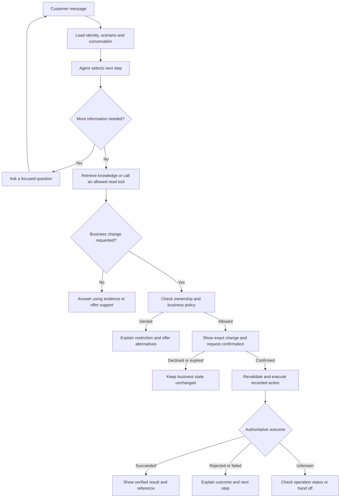
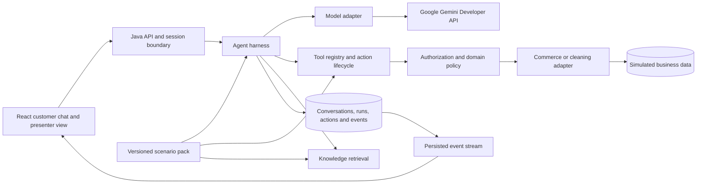

# Chatty — Reusable Agentic Service Assistant

Product requirements document · Version 0.3 · 10 October 2026

**Status: proposed for review. Implementation has not started.**

## 1. Product decision

Build a customer-facing AI assistant that can answer questions and complete permitted business tasks, with a visible execution flow for demonstrations and learning. Use **e-commerce support** as the first scenario and a small **cleaning-service sales/support** scenario to demonstrate reuse.

The product is a reusable **agentic harness**: the application runtime around the model that manages context, available tools, permissions, business rules, confirmations, execution, recovery, and evaluation. The model can choose the next useful step; the backend determines whether that step is allowed and whether it succeeded.

**Recommended stack:** Java 21 with Spring Boot, React with TypeScript and Vite, and PostgreSQL. Start with one Java application organized into modules. **AI provider: Google Gemini Developer API, using a Google AI Studio Free Tier project. Initial model: `gemini-3.8-flash`.** Use a Gemini adapter with the business workflow and state owned by our application. The user will supply the API key locally.

The prototype should make three things demonstrable:

1. A customer resolves a real conversational task against persistent, simulated business data.
2. A presenter can explain which information, tools, policies, and confirmations produced the outcome.
3. A developer can add a different industry through a scenario pack and adapters without rewriting the harness.

### Request and reference boundaries

The user requested a PRD first, allowed either Go or Java, allowed a choice of frontend technology and business scenario, and prioritized reuse, customer demonstrations, and learning. These are the requirements driving this proposal.

The user subsequently chose Gemini API to use an available free solution and offered to supply the key in the project. This provider and no-paid-service requirement supersede the earlier proposed OpenAI integration.

The attached screenshot describes a cleaning company and a SaaS CRM for cleaning businesses, with support and sales-call conversion needs. It is reference business context. Its recruitment language is not an instruction to hire anyone, contact anyone, or integrate with an existing company. No existing policies, systems, APIs, or customer data were supplied.

All merchant names, policies, data, performance thresholds, and scope choices below are **proposed prototype assumptions**. “Chatty” is a working name.

## 2. Users, outcomes, and boundaries

| User | Need | Successful outcome |
| --- | --- | --- |
| Customer | Ask naturally, get reliable answers, complete a supported task | An accurate answer, a verified change, or a clear route to human help |
| Presenter / product owner | Demonstrate value and explain the flow | A repeatable five-minute demo with visible decisions and before/after state |
| Developer / learner | Understand and extend the system | Can follow one run and implement another scenario without changing runtime code |

The initial release is a **local, single-operator demonstration product**, using English and synthetic data. It should have a credible foundation for customer pilots, but it is not a production SaaS launch.

### Required for prototype acceptance

- E-commerce: shipment tracking, eligible order cancellation, eligible delivery-address change, grounded FAQ, and a persisted support handoff request.
- Customer chat with clarification prompts, source references, action confirmations, useful error states, and resume after refresh.
- Presenter mode with a live execution graph/timeline, tool details, policy outcomes, business state, and scenario reset.
- A shared runtime, persisted operation lifecycle, bounded agent loop, and repeatable evaluations.
- A narrow cleaning-service pack: service FAQ, lead qualification, and a confirmed callback request.
- Two clearly identified model modes: **Live AI** and **Scripted rehearsal**. Both use the same backend policy and tool path. Rehearsal supports specified sample prompts; it is not represented as evidence of open-ended AI ability.
- Live AI uses Gemini with a user-supplied Free Tier project key. Do not enable billing, switch to a paid provider/model, or add paid managed services. Handle quota exhaustion explicitly; scripted rehearsal remains selectable without a key or provider calls.
- A complete simulator with documented dummy business endpoints, persistent state-changing operations, diverse seeded records, and one-command startup in scripted mode. The detailed [demo specification](docs/DEMO_SPEC.md), [seed data](demo/fixtures/seed.json), and [16 scenario definitions](demo/scenarios.json) are review artifacts already supplied; their runtime implementation is part of execution.

### Deferred until a customer pilot or later release

- Real commerce, payment, carrier, CRM, email, or calendar integrations; actual refunds and booked appointments.
- Production customer login, organization onboarding, billing, enterprise roles, and a full support-agent inbox.
- Voice, WhatsApp, social channels, multilingual support, arbitrary uploads, and open-web browsing.
- A visual workflow editor, autonomous outbound messaging, multiple-agent orchestration, and a plugin marketplace.
- Kubernetes, separate workflow infrastructure, and a vector database unless measured needs justify them.

## 3. What customers and presenters see

The main screen has a branded customer chat and an optional presenter panel. Every screen shows **Demo environment — simulated business systems**. Model mode is shown separately, so live model calls cannot be confused with live merchant integrations.

| Surface | Required behavior |
| --- | --- |
| Customer chat | Free-text input, starter prompts, concise progress labels, order/shipment cards, grounded FAQ citations, action previews, Confirm and Keep unchanged buttons |
| Execution flow | Highlight the current stage: understand request, obtain information, retrieve evidence, check policy, await confirmation, execute, verify, finish or hand off |
| Event inspector | Timestamp, run ID, tool name, redacted arguments/result, policy code, elapsed time, model usage, and status; expand details on demand |
| Business state | Show the relevant simulated record before and after a change, including its version and operation reference |
| Demo controls | Choose scenario and seeded customer, launch sample journeys, inject known failures, reset isolated demo data, and inspect previous runs |

The flow is driven by persisted runtime events. It must not invent steps or present hidden model reasoning. Short explanations such as “Address changes are unavailable after dispatch” come from explicit policy results. Customer mode hides technical details.

Use accessible keyboard navigation, labeled inputs, visible focus, readable contrast, and screen-reader announcements for status changes. On mobile, the presenter panel becomes a separate view. A confirmation is never conveyed by color alone.

### Customer flow

This is the shared lifecycle. The agent may perform several allowed reads or ask several questions before proposing an action. Each subsequent tool call returns through validation and the run's limits.

### Five-minute customer demonstration

| Step | Customer or presenter action | What it proves |
| --- | --- | --- |
| 1 | Ask “Where is my order?” with two seeded orders available | The assistant asks which order, then reports evidence-backed shipment status |
| 2 | Ask “Can you send the unshipped one to my new address?” | It uses conversation context, gathers missing fields, and checks policy |
| 3 | Inspect the proposed old/new address and click Confirm | The operation changes persistent demo data once and shows a verified result |
| 4 | Ask to cancel the shipped order | Backend policy rejects the change and offers support |
| 5 | Switch to the cleaning pack and request an office-cleaning callback | The same harness collects different information and creates a confirmed lead request |

Separate starter journeys cover a successful cancellation, FAQ, declined confirmation, stale order state, and a tool timeout. Reset restores a documented fixture set so demonstrations are repeatable.

The [end-to-end demo appendix](docs/DEMO_SPEC.md) specifies the HTTP contracts, sample business responses, eight order situations, failure controls, and a longer combined presentation in which address change, cancellation, tracking, FAQ, and support execute against shared persistent simulator state. Chat answers must derive from those facts and outcomes. Live AI wording can vary; business data is authoritative.

## 4. E-commerce journeys and proposed policies

The demo merchant is **Northstar Shop**, a fictional retailer. Orders and shipments have separate states. Example orders include one processing order, one order already shipped, one with multiple shipments, and one owned by another demo customer for isolation tests.

### EC-01 — Shipment inquiry

Customer: “Where is order NS-1002?”

1. Establish the customer from the server-issued demo session; an order number is not authentication.
2. Read the customer's order and associated shipments.
3. Return shipment status, latest tracking event, carrier reference, and ETA only if supplied by the adapter. Label timestamps and time zones.
4. When there are multiple shipments, show each separately. Clarify ambiguous order selection before proceeding.
5. If data is unavailable or stale, say so. Never infer that an order was delivered from an expected delivery date.

**Acceptance:** displayed facts match the retrieved fixture; an unauthorized order returns a neutral unavailable response; missing ETA produces no invented date.

### EC-02 — Order cancellation

Customer: “Cancel NS-1001.”

Proposed demo rule: the entire order can be canceled only in `PROCESSING` state, before any shipment is dispatched and while no fulfillment lock exists. Partial cancellation is deferred.

The assistant retrieves the order, obtains an eligibility result, and presents the affected order/items and cancellation consequences. No mutation occurs until the customer confirms the specific card. On confirmation, the backend rechecks current state and executes the cancellation atomically in the demo store.

A canceled order returns its persisted status and operation reference. If payment requires a refund, show **Refund requires processing — simulated; no money moved**. Order cancellation must not imply a completed refund. Already-canceled orders are reported accurately without another effect.

**Acceptance:** allowed cancellation persists; denied or declined cancellation leaves the order unchanged; a state change after preview is detected; repeated confirmation causes at most one cancellation effect.

### EC-03 — Shipment change: delivery address

Customer: “Send my order to a different address.”

For this prototype, “shipment change” means **changing the delivery address before dispatch**. Carrier rerouting, shipping-speed upgrades, recipient changes, and delivery-date changes are deferred.

Proposed demo rule: the order is `PROCESSING`, no shipment is dispatched, no fulfillment lock exists, and the new address is within the same supported country. The demo validates required address fields and supported regions; it does not claim postal deliverability verification.

The assistant collects missing fields, obtains policy eligibility, and presents the exact old/new address to the authenticated customer. Any edit to the proposed address requires a new confirmation. A rejected or stale proposal offers a supported next step.

**Acceptance:** only the confirmed address is persisted; an incomplete or unsupported address cannot execute; changes to a shipped order are rejected by the backend even if the model requests them.

### EC-04 — FAQ with evidence

Customer: “What is your return policy?”

Search the active merchant's approved knowledge collection. Answers identify the supporting article and version and stay within retrieved evidence. Account-specific questions use business tools rather than generic FAQ content. Unsupported or conflicting information produces a limitation and an offer of support.

**Acceptance:** cited sources exist, belong to the active scenario/workspace, and support the answer. Text inside documents cannot alter instructions, tool permissions, or business policies.

### EC-05 — Human handoff

Customer: “I need a person to help with this.”

Prepare a support request containing a concise conversation summary, relevant order references, attempted actions and their outcomes, and an optional customer note. Show the customer what will be submitted and obtain confirmation. Persist the ticket in the demo support queue and show its reference and actual queue status.

**Acceptance:** the ticket survives refresh and is visible to the presenter. The assistant says “Support request created,” not “A person is connected.” No email, external message, response-time promise, or automated human reply is implied.

## 5. Cleaning-service reuse proof

The second pack represents **ClearSpace Cleaning**, a fictional business inspired by the attachment. Keep this pack deliberately small:

- Answer approved FAQs about service areas, property types, cleaning options, and the cleaning-business CRM product.
- Distinguish a prospect seeking cleaning from a cleaning company seeking a CRM demonstration.
- For cleaning, collect property type, approximate size, area, service frequency, and contact preference. For CRM interest, collect company/team size, main need, and contact preference.
- Ask only relevant missing questions. Present a lead summary and request confirmation before creating a callback request in a simulated CRM.
- Return a request reference. A preferred time is a preference, not a booked appointment; availability checking and calendar booking belong to a later adapter.

**Reuse acceptance test:** switch between commerce and cleaning in the same deployed application. Both use the same chat, event viewer, confirmation lifecycle, storage conventions, and run engine. Only pack configuration, knowledge, domain policies, fixtures, and adapters differ. Automated architecture checks or a code review must confirm that the core runtime contains no commerce/cleaning branches.

## 6. Reusable product structure

| Layer | Shared responsibility | What varies by customer or industry |
| --- | --- | --- |
| Channel and UI | Chat, cards, confirmation controls, event stream, errors | Branding, vocabulary, starter prompts, enabled card types |
| Agent harness | Tool loop, conversation state, run lifecycle, budgets, recovery | Runtime settings within platform limits |
| Trust and policy boundary | Identity scope, authorization, confirmation verification, audit | Domain rules, action eligibility, required roles |
| Knowledge | Retrieval contract, source attribution, isolation | Approved documents and their versions |
| Tools and adapters | Registration, validation, execution contract, operation status | Order API, CRM, scheduling system, industry-specific operations |
| Evaluation | Runner, trace assertions, outcome reporting | Scenario cases, fixtures, expected policy outcomes |

A **scenario pack** contains a manifest, version, business instructions, terminology, allowed tools, tool schemas, policy settings, approved knowledge, demo fixtures, adapter bindings, and evaluation cases. Configuration references server-registered adapters; it cannot introduce arbitrary executable code or arbitrary network destinations.

Adding a new industry may require new adapter code, a domain validator, and a specialized card. Reuse does not mean that arbitrary business systems can be connected with prompts alone.

Onboarding path: define supported tasks → map authorized users/resources → supply knowledge and rules → implement adapters → add evaluations → validate in a sandbox → enable the pack. Record pack, policy, model, and tool-schema versions on every run. Configuration changes apply to new conversations; changed authorization and active business rules are always rechecked before a write.

## 7. Proposed architecture

### Technology choices

| Component | Proposal | Reason |
| --- | --- | --- |
| Backend | Java 21, Spring Boot, Maven | Typed domain contracts, validation, transaction boundaries, and a familiar path to enterprise integrations |
| Frontend | React, TypeScript, Vite; lightweight CSS/component system | Flexible chat cards and a responsive flow inspector without a second server-side application |
| Persistence | PostgreSQL with migrations | Conversations, action records, audit events, knowledge, and realistic transactional demo state in one database |
| Knowledge | PostgreSQL full-text search over curated articles initially | Sufficient for the small approved corpus; evaluate semantic retrieval before adding embedding infrastructure |
| Model | Google Gemini Developer API, initially `gemini-3.8-flash`, behind a Java interface | User-selected Free Tier provider with function calling; provider-specific types stay outside the domain model |
| Provider client | Official Google GenAI Java SDK, `com.google.genai:google-genai` | Keep model calls, function results, streaming, and provider continuation data within the Gemini adapter |
| Updates | HTTP commands plus Server-Sent Events | Stream progress and replay saved application events after reconnect |
| Local delivery | Docker Compose and documented development commands | Repeatable startup with seeded synthetic data |

Select compatible, maintained dependency versions at implementation time and pin them. Confirm that the supplied Free Tier project can access `gemini-3.8-flash` and run a small quality/latency evaluation. Keep the model configurable, but do not silently change the selected model or billing policy if access fails. A second production model provider is out of scope.

Google lists `gemini-3.8-flash` as a stable model with function calling and structured outputs. Function declarations describe available tools; our application validates requested calls, executes authorized handlers, and returns the correlated results. Keep schema validation and business policy enforcement in Java. [Official model documentation](https://ai.google.dev/gemini-api/docs/models/gemini-3.8-flash), [official function-calling documentation](https://ai.google.dev/gemini-api/docs/function-calling)

Use the official Java SDK and handle tool execution explicitly through the harness so SDK convenience behavior cannot bypass confirmations or policy checks. Preserve provider-required continuation data, including opaque thought signatures when applicable, inside the adapter and stored checkpoints; do not show them as model reasoning in the presenter view. [Official SDK documentation](https://ai.google.dev/gemini-api/docs/libraries), [function calling with thinking models](https://ai.google.dev/gemini-api/docs/function-calling#function_calling_with_thinking_models)

### Free Tier, credentials, and quota behavior

The following provider facts were checked on 10 October 2026. Google currently lists Standard input/output usage for `gemini-3.8-flash` as free on Free Tier. This is a quota-limited offering, not a promise of unlimited or permanently free API access. The user must supply a key from a Free Tier project; app configuration cannot turn a paid Google project into a free one. Do not enable billing or account upgrades as part of this prototype. [Official pricing](https://ai.google.dev/gemini-api/docs/pricing)

Google's active request/token quotas vary by project, tier, and model and are visible in AI Studio; they apply to the project rather than to each key. Do not hardcode a universal free request allowance. Configure local limits to the supplied project's actual allowance and begin with one concurrent live run, displaying queued status for other sessions. Every model round counts as a provider request, so a single customer turn can consume several requests. [Official rate limits](https://ai.google.dev/gemini-api/docs/rate-limits)

- Read `GEMINI_API_KEY` from a server-side environment variable. The user can copy the supplied [configuration template](.env.example) to `.env` and fill the key locally. The implementation must explicitly pass this variable to the SDK so an unrelated `GOOGLE_API_KEY` does not take precedence. [Official API-key guidance](https://ai.google.dev/gemini-api/docs/api-key)
- The planned Docker Compose configuration passes the key only into the Java backend. Spring/local development must also load or receive these settings explicitly; the existence of an `.env` file alone does not configure Java. Never expose the key through Vite/public environment variables, diagnostic endpoints, or the event stream.
- Missing/invalid keys or unavailable models produce a clear live-mode setup error. Scripted mode starts without credentials. Key presence checks and error reports never print the key.
- On rate-limit or quota responses, show a specific provider-limit outcome and preserve conversation/action state. Honor provider retry timing within the active-run budget; do not loop aggressively or replay already-dispatched business actions. No automatic paid fallback or silent switch to rehearsal mode.
- Retrieval stays in the local approved knowledge store; the demo does not depend on Google Search/Maps grounding, paid embedding services, or managed agent hosting.
- Google's pricing page lists Free Tier content as usable for product improvement. The prototype therefore uses only the supplied synthetic data in live requests. [Official pricing and data-use comparison](https://ai.google.dev/gemini-api/docs/pricing)

Configuration and local key placement are documented in [Gemini setup](docs/GEMINI_SETUP.md). These files define the planned configuration; the provider adapter and Compose wiring will be implemented during execution.

### Modules and contracts

Proposed modules: `api`, `harness`, `model-adapters` with a `gemini` implementation, `tool-runtime`, `knowledge`, `observability`, `scenario-commerce`, and `scenario-cleaning`. Use ordinary module boundaries in one deployable backend. No microservice split is required.

Every tool registration specifies its name/version, argument and result schemas, read/write classification, required authorization, timeout, idempotency behavior, and handler. Example domain tools are `get_order`, `get_shipments`, `prepare_cancellation`, `prepare_address_change`, `search_knowledge`, `prepare_support_request`, and `prepare_callback_request`.

Preparation tools return a typed proposal or rejection. The model never receives a general-purpose mutation endpoint. A backend confirmation endpoint executes only the previously recorded proposal. Executed results are available to subsequent agent steps; immediate action outcome messages use backend templates tied to the operation ledger. This preserves agent choice while giving the action lifecycle an explicit trust boundary.

## 8. Harness behavior and action safety

### Bounded agent loop

1. Authenticate the session and load workspace, scenario version, conversation, and structured task state.
2. Assemble approved instructions, relevant history, tool definitions, and scoped evidence.
3. Request a model response. Interpret output as a reply, clarification, or proposed tool call.
4. Validate tool name and arguments, authorize access, and evaluate applicable policy in application code.
5. Execute an allowed read, or persist a proposed write and pause for customer confirmation.
6. Record the result and supply it to the next model step when needed.
7. Finish with evidence, wait for user input, or stop safely on a limit/error.

Proposed starting limits per active run: six model requests, ten tool calls including retries, and 60 seconds of active processing. Human wait time is excluded; confirmation expires after five minutes and an input wait expires after 15 minutes. Model requests have a 20-second deadline; tools have a five-second timeout unless explicitly configured otherwise. Allow one retry for transient read failures and one repair attempt for invalid model arguments, within the same limits. Never retry a non-idempotent write blindly.

Only one active run and one outstanding action proposal may exist per conversation in the prototype. Independent reads are initially serial for clarity. Conflicting user requests require clarification. An edited action invalidates the previous proposal. Durable facts and active action IDs are stored structurally; a conversation summary cannot grant authorization.

### Run state and business operation state

Run states: `QUEUED`, `RUNNING`, `WAITING_FOR_INPUT`, `WAITING_FOR_CONFIRMATION`, `COMPLETED`, `FAILED`, and `STOPPED`. A persisted wait resumes from new input or a confirmation event. Expired waits become `STOPPED` with a recorded reason and invalidate any unexecuted proposal. A later message can start a fresh run using the saved conversation. Browser disconnection does not imply cancellation or a new run.

On startup, recover orphaned `QUEUED`/`RUNNING` runs. An interrupted model/read step may be safely resumed within its remaining limits or marked `FAILED` with a retry option. Reconcile any dispatched action before deciding its result. No interrupted run may permanently occupy the conversation's active-run slot. Persist attempt counts and elapsed-budget checkpoints so a restart does not reset execution limits.

Business actions have a separate ledger: `PROPOSED`, `CONFIRMED`, `EXECUTING`, then `SUCCEEDED`, `REJECTED`, `FAILED`, or `UNKNOWN`; unexecuted proposals may be `DECLINED`, `EXPIRED`, or `SUPERSEDED`. Unknown outcomes enter status reconciliation, eventually resolving or remaining visibly pending for human investigation. The run may finish by reporting that pending outcome; it must not claim completion of the business action. Block further mutations of the unresolved resource, while still allowing an independently confirmed support ticket about it.

“Stop assistant” prevents additional model/tool scheduling and invalidates unexecuted proposals. It cannot undo an action already dispatched. An order cancellation is a business operation, distinct from stopping a run.

### Confirmation, concurrency, and retries

- Persist an action ID before confirmation, bound to workspace, customer, conversation, operation type, exact normalized parameters, resource version, policy version, and expiry. Use a server-generated operation ID, not a model-generated tool-call ID, for deduplication.
- Confirm/decline controls refer to that action ID. In this MVP, a typed “yes” directs the customer to the current confirmation card; text alone does not authorize a write.
- On confirmation, authenticate again, verify the proposal binding, recheck permissions and current policy, and check current resource version. A changed resource or changed proposal requires a fresh preview and confirmation.
- Enforce policy preconditions at the mutation boundary. The local demo adapter combines the condition check, data mutation, operation result, and audit event in a database transaction. A separate earlier policy check cannot prevent a dispatch race by itself.
- Duplicate confirmation and transport retries return the existing operation result. Concurrent writes to the same resource cannot both pass an obsolete version check.
- If an external-style failure leaves the outcome uncertain, query by stable operation ID. If no authoritative status exists, keep the action pending and offer support; never announce success or repeat a potentially completed write.
- On process restart, reload waiting proposals and reconcile in-flight operations before executing further writes. Replaying an event trace is read-only and never re-executes tools.

## 9. Data, trust, and operational requirements

Core records: workspace, demo principal, scenario version, conversation, message, run, run event, tool invocation, action proposal/operation, knowledge article/version, and handoff ticket. Commerce and cleaning own separate domain records linked through workspace and opaque resource IDs.

Each event has a monotonic sequence within a run, event type, timestamp, correlation IDs, safe display payload, and redacted diagnostic detail. Persist events before streaming them. The UI reconnects with its last event ID, deduplicates delivery, and retrieves the current run/action snapshot. Client-generated message IDs prevent duplicate runs after a network retry.

| Requirement | Prototype behavior |
| --- | --- |
| Customer identity | Demo-only selector establishes a server-controlled synthetic identity; every record lookup still enforces ownership. Client/model arguments cannot select the authorization scope |
| Workspace isolation | All records, retrieval filters, tools, and traces are scoped server-side; switching scenarios starts a separate conversation and cannot carry pending approvals across |
| Presenter access | Separate local presenter session; trace/reset endpoints are unavailable to customer sessions. A public customer pilot must replace demo access controls |
| Sensitive data | Synthetic data only; redact contact/address details in diagnostic traces; customer action cards display only their authorized data |
| Credentials | Server-side secrets only; never in browser bundles, prompts, exported traces, source control, or knowledge documents |
| Untrusted content | Treat customer messages, retrieved articles, and tool text as data. They cannot register tools, override policy, or authorize execution |
| Tool boundary | Allowlisted functions and destinations; schema and semantic validation. No general SQL, shell, browser, or arbitrary URL-fetch tool |
| Truthful results | Action proposals and outcome messages, including status prose and consequences, use backend templates bound to the saved proposal/operation. On turns containing an action, suppress model-authored completion claims. Later questions about an action retrieve its current status and use the same renderer; generation failure never repeats the operation |
| Reset and retention | Reset only the presenter's isolated demo workspace, refuse while a write is executing/unknown, and invalidate prior sessions/proposals. Injected unknown outcomes have a presenter-controlled reconciliation command that reads authoritative simulator records and resolves to a terminal status before reset; it cannot invent success or re-execute the action. Provide local synthetic-data purge; pilot retention rules require separate agreement |
| Request limits | Configurable message-size, session-rate, model/tool-step, time, and usage limits; record provider usage when available and expose unknown usage rather than assuming zero |

Do not describe local-only operation as implying that live AI processing remains on the machine. Live mode sends the selected, minimized conversation/tool context to the model provider. Before using real customer data, review identity, access, provider data handling, consent requirements, retention, and the chosen deployment with the customer.

## 10. Evaluation and acceptance

All values below are proposed targets, not measured results. Product acceptance combines deterministic state assertions with live-model conversational evaluation. Success is determined from tools and stored business state, not solely from another model grading the final text.

| ID | Acceptance condition | Evidence |
| --- | --- | --- |
| A1 | Every commerce journey and cleaning journey reaches the expected outcome | Saved demo scripts, fixtures, resulting business records, and traces |
| A2 | Zero unauthorized writes; exact confirmation required for every proposed mutation | Tests for forged/expired approvals, edited parameters, cross-customer/workspace IDs, and typed “yes” |
| A3 | Duplicate/concurrent requests cause at most one intended business effect | Integration tests covering duplicate messages, repeated clicks, version races, and restart after dispatch |
| A4 | No success claim on rejected, failed, or unknown operations | Failure-injection traces and checks that both cards and action-status prose derive from authoritative operation state |
| A5 | Retrieved instructions cannot escalate permissions | Adversarial prompts and knowledge fixtures attempting policy overrides, tool injection, and cross-workspace access |
| A6 | Grounded FAQ answers cite supporting scoped articles; unsupported questions are acknowledged | Human-reviewed answer/source pairs and negative cases |
| A7 | Every attempted tool invocation and policy denial has a visible correlated event; interrupted runs cannot leave the conversation stuck | Trace completeness, reconnect/refresh, and crash recovery checks during model, read, wait, and write stages |
| A8 | Both packs use the same runtime and action lifecycle | Architecture review and a pack-switch demonstration without core code changes |
| A9 | Live AI handles at least 90% of all supported-task evaluation executions correctly | At least 50 cases, three runs per case: at least 135 of 150 executions must pass for the minimum set. Report per-journey scores and variability; critical safety failures still block release |
| A10 | All critical authorization, confirmation, isolation, and duplicate-effect checks pass | 100% pass rate for deterministic safety cases; any observed safety violation blocks the demo release |
| A11 | One command starts the complete scripted demo without external business systems or a model service, and all 16 supplied journeys can be demonstrated | Startup smoke check, idempotent seed loading, documented HTTP responses, persistent before/after data, reset checks, and the combined demo in the appendix |
| A12 | Live AI uses the selected Gemini model and local key; missing credentials and provider quota errors leave the demo usable without paid fallback | Gemini adapter smoke check after key setup; injected key/access/429 failures; explicit model/mode display, saved-state checks, and a user-selected rehearsal run |

The evaluation set includes happy paths, ambiguity, missing information, multi-intent requests, ineligible orders, partial shipments, conflicting policies, malicious retrieved text, canceled confirmations, stale state, disconnections, timeouts, model outages, provider quota exhaustion, and unknown write outcomes. A correct denial or honest pending status is the expected result for relevant cases. Scripted rehearsal results are reported separately from live-model results. Schedule live evaluation batches within the Free Tier quota, potentially across multiple quota windows. Quota-aborted runs are recorded separately and rerun later to complete the required sample; they are not counted as successful conversational evaluations.

Proposed usability/performance targets: show a local acknowledgement within one second; support up to five open demo sessions, with one active live run by default to respect the shared provider quota. On a documented development machine/network, target p95 active live read-only turns within 15 seconds and post-confirmation outcomes within 20 seconds, excluding queue/human waiting and injected failures. Measure and report queue time separately. Revise targets explicitly if Gemini benchmarks or available Free Tier quotas disagree. Show progress while waiting and enforce the active-run deadline.

Track completion rate, handoff rate and reason, confirmation acceptance/decline, tools per run, failures/retries, latency, available token usage, model requests, and provider-limit events. The prototype targets zero provider charges using the supplied Free Tier project; log usage and quota behavior rather than promising unlimited free capacity. Future paid-pilot estimates require a dated provider/model rate card. Production conversion or support-cost savings require a customer baseline and pilot.

## 11. Execution increments after approval

| Increment | Deliverable | Exit condition |
| --- | --- | --- |
| 1 — Foundation | Application skeleton, versioned pack contract, idempotent loading of supplied fixtures, dummy read endpoints, session boundaries, persistence, shared tool/operation interfaces, scripted model adapter, Docker Compose | A read-only journey runs from one-command startup, produces an inspectable persisted run, and survives refresh |
| 2 — Live agent and commerce | Gemini Java adapter, local-key configuration, quota handling, bounded loop, FAQ retrieval, tracking, cancellation/address proposals, confirmations and mutation lifecycle | Live Gemini completes the commerce journeys within available Free Tier quota; authorization, policy, duplicate-effect, and failure checks pass |
| 3 — Customer demonstration | Polished chat/cards, event flow, state inspector, handoff queue, documented dummy mutation endpoints, OpenAPI/Swagger, failure controls, reset and rehearsal mode | Presenter completes the combined end-to-end script and all supplied simulator journeys, and shows recovery without editing data manually |
| 4 — Reuse and validation | Cleaning pack, evaluation set, automated checks, performance report, onboarding guide, architecture notes | Both packs pass their acceptance cases and the core runtime remains domain-independent |

Each increment should leave a runnable product and a short learning note explaining the agent loop, retrieval, tool contracts, or action lifecycle demonstrated. Required delivery artifacts are the source repository, local startup instructions, synthetic fixtures, scenario-pack guide, demo script, and an evaluation report distinguishing observed results from remaining limitations.

A schedule estimate should follow the first runnable increment and account for the desired UI polish and model access. No production integration or hosting time is included in this prototype scope. Public deployment is a separate delivery decision.

### Main risks and responses

| Risk | Response |
| --- | --- |
| Scope grows into two complete industry products | Keep the cleaning pack to FAQ and confirmed callback intake |
| “Agentic” is implemented as a scripted router only | Require live-model tool choice, clarification, and handling of paraphrased/multi-intent cases |
| Model output bypasses business rules | Enforce authorization, policy, and exact-action confirmation at the backend execution boundary |
| Demo works only with lucky model responses | Keep repeatable fixtures/evaluations and a visibly labeled rehearsal mode; never silently substitute it |
| Free Tier quota interrupts a live presentation | Serialize live runs, limit model rounds, show provider-limit status, and provide explicitly selected rehearsal mode; no billing upgrade or paid fallback |
| Real systems cannot support safe retries | Record connector idempotency/status capabilities; route uncertain outcomes to reconciliation/humans |
| Generality creates an oversized framework | Prove two packs first; add abstractions only where both use them |

## 12. Review and execution decision

**Proposed execution scope:** Java/Spring Boot + React, e-commerce as the primary pack, cleaning FAQ/callback intake as the reuse proof, application-owned agent orchestration, simulated business integrations, and live AI using the user-selected Google Gemini Free Tier project with `gemini-3.8-flash` initially.

This document is the review deliverable. Approval of it authorizes implementation planning and development within this scope; it does not authorize external customer communications, use of real customer data, production deployment, or real financial/business transactions.

Provider selection is resolved: Google Gemini. The user will supply `GEMINI_API_KEY` locally in `.env`; no key creation or provider-selection approval is required. At implementation kickoff, check credential presence without revealing its value and validate model access when live testing is needed. No credentials are needed for PRD review or scripted rehearsal. Existing merchant integrations and hosting can be selected later when moving from demonstration to pilot.
