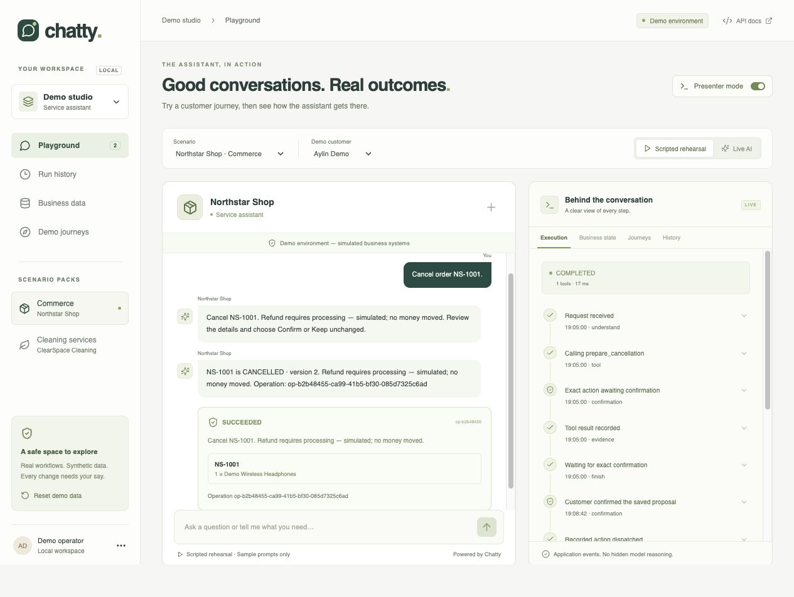
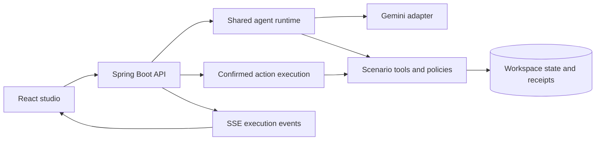

# Chatty

A local AI service assistant that reads business records, answers questions, and completes permitted tasks after the customer confirms the exact change.

Chatty combines a customer chat with a presenter view of tool calls, retrieved evidence, proposals, and persisted outcomes. Two scenario packs demonstrate the same runtime: **Northstar Shop** for commerce support and **ClearSpace Cleaning** for service enquiries and callback intake.



> Local prototype with synthetic business data. Live Gemini integration is verified, but live responses can take about a minute. This project is not production-ready; see [verification and limitations](#verification-and-limitations).

## What it does

| Scenario | Supported workflows |
| --- | --- |
| Commerce | Shipment tracking, eligible order cancellation, delivery-address changes within Turkey, approved FAQs with citations, and support-request intake |
| Cleaning services | Approved FAQs, cleaning-service qualification, CRM-demo qualification, and callback-request intake |
| Shared studio | Customer selection, execution timeline, business-state inspection, saved run history, repeatable journeys, and failure simulation |

Business systems are simulated. A support request is saved as **QUEUED**, and a callback request as **REQUESTED**. Neither connects a human, books a calendar appointment, sends an external message, nor moves money.

## Quick start

### 1. Get the project

```sh
git clone https://github.com/alpercandemir/chatty-bot.git
cd chatty-bot
cp .env.example .env
```

For Live AI, edit `.env` locally and set `GEMINI_API_KEY` to your Google AI Studio key. Leave it blank to explore scripted rehearsal without provider calls. `.env` is ignored by Git and is passed only to the backend.

### 2. Run locally

**Native development — macOS or Linux**

Requirements: Java 21, Maven 3.9+, Node.js 22.12+ and npm. Python 3 is needed only for the HTTP evaluation scripts.

```sh
./scripts/dev.sh
```

This builds the backend, installs and builds the frontend, then starts both development services. Native development stores persistent simulator data in an H2 database under `data/`.

Open [the studio](http://127.0.0.1:5173/). The backend runs on port **8080**.

**Docker Compose**

With Docker and Compose running:

```sh
docker compose up --build
```

Open [the studio](http://localhost/). Compose uses PostgreSQL for persistence and Nginx for the frontend. Services bind to loopback; the database is stored in the `chatty-data` volume. Stop the stack with `docker compose down`.

### 3. Choose a mode

| Mode | Behaviour |
| --- | --- |
| **Live AI** | Gemini interprets natural requests, selects registered tools, asks follow-up questions, and writes answers from returned evidence. Requires a key and model access. |
| **Scripted rehearsal** | A deterministic, pattern-based adapter for the supplied prompts and documented variants. Makes no provider calls; it is not a general conversational assistant. |

`AI_MODE=auto` selects Live AI for new conversations when a key is configured, otherwise scripted rehearsal. Existing conversations keep their selected mode. Use the mode buttons to start a new conversation; changing mode or customer starts a new customer session.

Live mode never silently falls back to rehearsal. Provider failures are reported explicitly, and the configured model is not automatically changed.

## Try a conversation

Choose **Northstar Shop** and **Aylin Demo**. Use Live AI for natural follow-ups, or scripted rehearsal for the exact sample messages below. After experimenting, use **Reset demo data** to restore the fixtures.

**Track a shipment**

```text
Where is order NS-1002?
```

The assistant retrieves the order and shipment facts, including carrier, tracking reference, latest event and available delivery estimate.

**Change an address**

Send this message:

```text
Change the delivery address for NS-1001.
```

Then send the address as a separate message:

```text
Ornek Bulvar 25, Daire 5, Atasehir, Istanbul, 34000, Turkey.
```

Review the current and proposed address, then choose **Confirm** or **Keep unchanged**. Copy only the message text, rather than the surrounding walkthrough instructions. An address wrapped in backticks is accepted; walkthrough text mixed into the street address is rejected.

In Live AI, you can also ask a follow-up such as:

```text
Is it really necessary to specify city?
```

**Cancel an order or request support**

```text
Cancel order NS-1001.
```

Eligible changes require confirmation. For an already dispatched order, try:

```text
Cancel order NS-1002.
```

Then:

```text
Please create a support request about this order.
```

The persisted handoff is a simulated support-queue entry, not a live human connection.

**Qualify a cleaning enquiry**

Switch to **ClearSpace Cleaning** and send:

```text
I need weekly cleaning for a 250 square meter office in Atasehir. Please contact office@example.invalid next weekday afternoon.
```

Review the callback details before confirming. The preferred time is a preference, not a booked appointment.

## Explore the execution

Turn on **Presenter mode** to inspect:

- **Execution:** registered tool calls, evidence, policy checks, confirmations and outcomes.
- **Business state:** persisted orders, proposals, operations and request records.
- **Journeys:** all 16 supplied scenarios, with explicit customer and presenter steps.
- **History:** saved runs and their execution events.

For a repeatable demonstration, choose a journey, select **Prepare this journey**, and use **Run next step**. Preparing a journey resets that presenter workspace.

Failure controls demonstrate an unavailable read with one retry, a write failure before commit, a stale proposal, and a lost response after commit. An **UNKNOWN** operation stays uncertain until the presenter reconciles its saved receipt; it is not automatically retried or reported as successful. Pending operations block conflicting changes and resets.

## Configuration

| Variable | Default | Purpose |
| --- | --- | --- |
| `GEMINI_API_KEY` | Empty | Backend-only Gemini credential |
| `AI_MODEL` | `gemini-3.8-flash` | Selected model; no automatic model switch |
| `AI_MODE` | `auto` | `auto`, `live`, or `scripted` |
| `AI_MODEL_MAX_ROUNDS` | `6` | Maximum model requests per run; capped at six |
| `DATABASE_URL` | Local H2 file | JDBC connection; Compose supplies PostgreSQL settings |
| `DATABASE_USER`, `DATABASE_PASSWORD` | Local demo values | Database credentials |

Restart the backend after changing `.env`. The native scripts parse supported `KEY=value` settings without executing `.env` contents.

Live runs use low reasoning effort, one active provider run at a time, a maximum of ten tool attempts, a 45-second provider deadline and a 120-second active run budget. Queue time is recorded separately. These bounds replaced the initial shorter deadlines after a generation probe took 32.5 seconds.

The intended provider setup is a Google AI Studio Free Tier project with access to the selected model. The application cannot inspect or change the project's billing tier. Quota, credential, model-access and connection errors are surfaced without enabling billing or switching to a paid fallback. See [Gemini setup](docs/GEMINI_SETUP.md).

## Architecture

- **Backend:** Java 21, Spring Boot, official Google GenAI Java SDK, JDBC and Flyway.
- **Frontend:** React, TypeScript, Vite and Lucide icons.
- **Persistence:** H2 for native development; PostgreSQL in Compose.



Gemini chooses permitted next steps, but Java owns sessions, tool registration, argument validation, authorization, business policies, confirmation and persistence. Preparation tools create proposals; they cannot execute changes. Confirmation rechecks the saved proposal and current resource version within the database transaction. Duplicate confirmations reuse the recorded outcome.

Model-authored read answers and clarifications reach the chat, with retrieved sources attached to saved messages. Exact action previews, policy denials, unsupported retrieval and verified operation outcomes are rendered from backend evidence. The event viewer shows application events, not hidden model reasoning.

Scenario packs supply instructions, schemas, tool handlers, policies and fixtures. They are registered server components, not dynamically loaded plugins. See the [architecture](docs/ARCHITECTURE.md) and [scenario-pack guide](docs/SCENARIO_PACK_GUIDE.md).

## Verification and limitations

Observed locally on **10 October 2026**:

| Check | Result |
| --- | --- |
| Backend acceptance and safety suite | **27 tests passed**, including all 16 supplied journeys |
| Public-HTTP scripted evaluation | **50 / 50 passed** |
| Java package and frontend production bundle | Built successfully |
| Real Gemini tracking | Completed with 2 model requests and 2 tool calls |
| Real Gemini address follow-up | Answered the city question directly with an approved address-policy citation |
| Browser persistence | Conversation and confirmed simulator state survived reload |
| Docker Compose configuration | Validated; image startup and PostgreSQL execution remain unverified |

The scripted score is not a live-model accuracy score. The PRD's full live evaluation target has not been achieved. Individual live browser turns took about 57–58 seconds of active time, so the original 15-second read target is not met. See the [evaluation report](docs/EVALUATION_REPORT.md), [tracking evidence](docs/evaluation/live-smoke.json), and [live conversation screenshot](docs/live-verification.jpg).

This is a local, single-operator prototype. Public hosting, production customer authentication and real merchant connectors are outside its current scope. PostgreSQL migrations and full-text retrieval are implemented but have not been tested against a running PostgreSQL instance here. Further work includes complete typed domain/result contracts, dynamic pack onboarding and broader adversarial/live evaluation.

### Run the checks

From the repository root, with Java 21 selected:

```sh
mvn -f backend/pom.xml test
npm --prefix frontend ci
npm --prefix frontend run build
```

With the backend running:

```sh
python3 scripts/evaluate.py --mode scripted --limit 50
```

For a small real-provider check:

```sh
python3 scripts/live-smoke.py
```

For the larger live evaluation, run only within your project's available quota:

```sh
python3 scripts/evaluate.py --mode live --limit 50 --repetitions 3 --output docs/evaluation/live.json
```

HTTP evaluations use a separate presenter workspace and reset it between cases. Provider setup and quota failures abort the live batch and are recorded separately rather than counted as passes.

## API and project layout

Open the studio first to establish the local presenter cookie, then visit [Swagger UI](http://127.0.0.1:8080/swagger-ui.html). Keep the same hostname as the studio; when using Compose, use `localhost` for both. Customer chat uses server-issued sessions, while presenter controls and internal simulator endpoints require presenter access.

```text
backend/        Spring Boot API, runtime, scenario packs, persistence and tests
frontend/       React customer chat and presenter studio
demo/           Synthetic fixtures and 16 repeatable scenarios
scripts/        Local startup, provider smoke test and HTTP evaluations
docs/           Architecture, API contracts, setup and evaluation evidence
compose.yaml    PostgreSQL, backend and frontend services
PRD.md          Product requirements and acceptance criteria
```

Further reading:

- [Product requirements](PRD.md)
- [End-to-end demo specification](docs/DEMO_SPEC.md)
- [HTTP examples](docs/API_EXAMPLES.md)
- [Learning notes](docs/learning/README.md)

## Troubleshooting

- **The bot only understands sample prompts:** check whether the selected mode is Scripted rehearsal. Choose Live AI for ordinary follow-up questions.
- **Missing key or model access:** set the key in `.env`, restart the backend, and verify that your project can access the configured model. The app preserves the selected provider and model.
- **Quota exhausted:** wait for the project's quota reset or explicitly select scripted rehearsal.
- **Long live replies:** the UI displays progress and offers **Stop assistant**. The active run remains bounded; stopping does not undo an already dispatched operation.
- **Ports already occupied:** stop the previous local services before starting another stack. Native development and Compose both use backend port 8080.
- **Expired session after reset:** select the demo customer again to establish a fresh session.
- **UNKNOWN operation blocks reset:** reconcile its authoritative receipt in Business state first.
