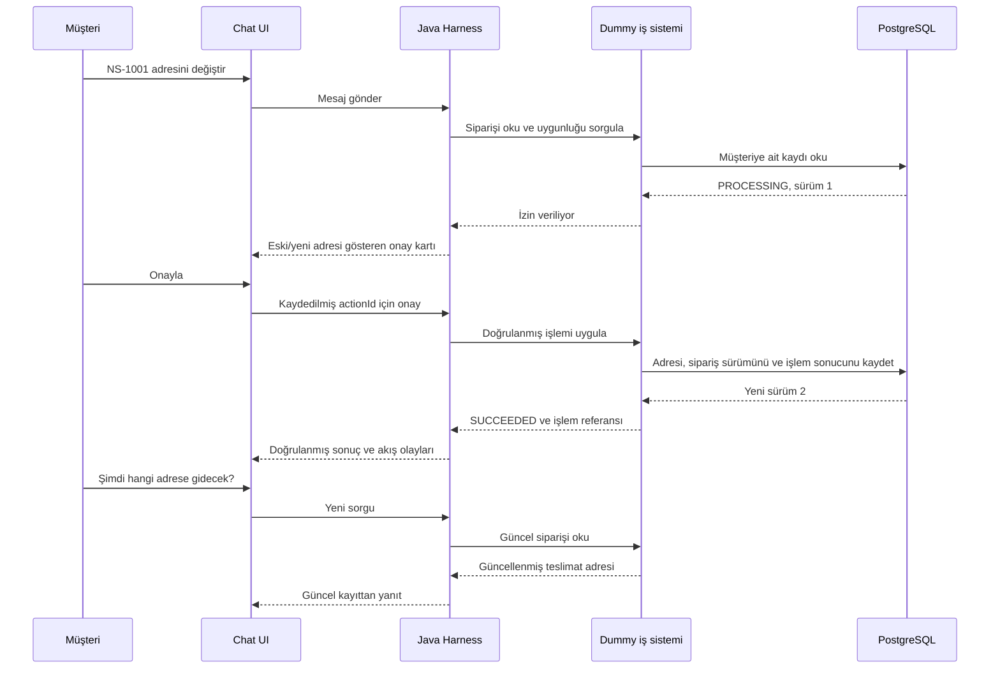

# Uçtan uca demo: veri, dummy API ve sunum akışları

**Durum:** Uygulama, simulator endpointleri ve 16 scripted senaryo implemente edildi. Ölçülen sonuçlar ve canlı/PostgreSQL doğrulama sınırları [evaluation report](EVALUATION_REPORT.md) içinde.

Bu ek, kullanıcının 10 Ekim 2026 tarihli talebini somutlaştırır: uygulama ayağa kalkınca dış iş sistemlerine ihtiyaç olmadan, farklı senaryolarla uçtan uca müşteri sunumu yapılabilmelidir. Buradaki şirketler, kişiler, ürünler ve politikalar kurgusaldır.

## 1. Çalıştırılabilir demo için teslim koşulu

Implementasyon tamamlandığında `docker compose up --build` veritabanını, Java backend'i ve frontend'i başlatmalı; ilk açılışta örnek verileri yüklemeli ve hazır bir sunum ekranı açılabilir olmalıdır. Compose yapılandırması teslim edilmiştir; bu geliştirme oturumunda Docker daemon mevcut olmadığı için image startup doğrulanmadı. Yerel Java/H2 + Vite akışı çalıştırıldı.

- Varsayılan **Scripted rehearsal** modu, tanımlı sunum akışlarını AI sağlayıcısına veya dış servislere bağlanmadan çalıştırır.
- **Live AI** modunda Google Gemini Developer API kullanılır; başlangıç modeli `gemini-3.8-flash`, hedef kullanıcı tarafından sağlanan Google AI Studio Free Tier projesidir. Model araçları seçer ve açıklamalar üretir; aynı dummy iş API'leri, veri kayıtları, politikalar ve onay mekanizması kullanılır. [Model belgesi](https://ai.google.dev/gemini-api/docs/models/gemini-3.8-flash), [ücretsiz katman fiyatlandırması](https://ai.google.dev/gemini-api/docs/pricing)
- Model erişimi kesilince mod sessizce değiştirilmez. Seçili mod görünür ve hata açıkça belirtilir.
- Simulator sabit başarı cevapları döndürmez: kayıt okur, uygunluğu değerlendirir ve onaylanan değişikliği kalıcı olarak kaydeder.
- Sayfa yenilendiğinde adres, sipariş durumu, destek talebi ve onay bekleyen işlem korunur.
- Her bağımsız senaryo reset ile başlar. Birleşik sunum akışında adımlar aynı veri durumu üzerinde ilerler.
- Dummy API'ler için OpenAPI/Swagger dokümanı ve örnek HTTP istekleri uygulamayla birlikte teslim edilir.

Key yerleşimi ve planlanan ayarlar [Gemini kurulum notunda](GEMINI_SETUP.md) açıklanmıştır. Kullanıcı `.env` içine `GEMINI_API_KEY` değerini ekler; backend bu değeri okur. Ücretsiz kota aşıldığında chat açık bir kota durumu gösterir; konuşma ve kayıtlı işlemler korunur. Kullanıcı isterse görünür biçimde rehearsal moduna geçebilir. Ücretli modele/projeye otomatik geçiş yapılmaz. [Kota belgesi](https://ai.google.dev/gemini-api/docs/rate-limits)

Chat, harness, simulator ve veritabanı arasındaki yol:



## 2. Hazırlanmış veri dosyaları

- [`seed.json`](../demo/fixtures/seed.json): iki iş alanı, dört demo kimliği, sekiz sipariş, beş gönderi kaydı, on bilgi makalesi ve iki örnek temizlik/CRM müşteri profili.
- [`scenarios.json`](../demo/scenarios.json): 16 sunum senaryosu; müşteri mesajları, UI adımları, hata enjeksiyonları ve beklenen iş sonuçları.

`cleaningProfiles` örnek girişlerdir; müşterinin söylemediği bilgi olarak modele otomatik eklenmezler. Canlı mod ilgili alanları konuşmadan toplar. `initialRecords` içindeki operasyon, destek ve callback listeleri boş başlar; demo sırasında oluşur.

Para tutarları `totalMinor`/`unitPriceMinor` alanlarında kuruş olarak tutulur: `249900 TRY` = `2.499,00 TL`. Simulator fiyat hesabını modelin tahminine bırakmaz. Tarihler reset anına göre dakika farkıyla tanımlıdır; seed yükleyici bunları gerçek ISO 8601 zamanlarına dönüştürür. Örneğin `-60`, reset anından bir saat önce; `2880`, iki gün sonradır. Bu, sunum tarihleri eskimeden tekrar kullanılabilir bir veri seti sağlar.

### Sipariş çeşitliliği

| Kayıt | Demo sahibi | Başlangıç durumu | Gösterilecek davranış |
| --- | --- | --- | --- |
| NS-1001 | Aylin | PROCESSING, kilitsiz | İptal veya adres değişikliği için onay alınabilir |
| NS-1002 | Aylin | SHIPPED / IN_TRANSIT | Kargo bilgisi ve tahmini teslimat; iptal/adres değişikliği reddedilir |
| NS-1003 | Aylin | DELIVERED | Teslim edilmiş gönderi; iade FAQ'sına veya desteğe yönlendirme |
| NS-1004 | Aylin | CANCELLED | Daha önce iptal edilmiş; ikinci iptal yapılmaz ve iade tamamlandı denmez |
| NS-1005 | Aylin | PROCESSING, fulfillmentLocked | Depo kilidi nedeniyle değişiklik reddedilir |
| NS-1006 | Aylin | PARTIALLY_SHIPPED | Bir paket yolda, diğeri sevk bekliyor; iki ayrı durum gösterilir |
| NS-1007 | Mert | PROCESSING | Aylin bu siparişi görüntüleyemez/değiştiremez |
| NS-1008 | Aylin | SHIPPED / DELAYED, ETA yok | Gecikme açıklanır; teslim günü uydurulmaz |
| NS-9999 | Yok | Kayıt yok | Nötr bulunamadı yanıtı; başka müşterinin kaydıyla aynı dış hata |

İlk kısa sunum için sipariş seçimi açılır. “Where is my order?” birden fazla olası kayıt olduğundan açıklama sorusu üretmelidir. Senaryolar İngilizce örnek mesajlar kullanır; bu ek sunum hazırlığını Türkçe açıklar.

## 3. Uygulama endpoint sözleşmeleri

Path'ler implementasyon için önerilen sözleşmelerdir. Browser yalnızca `/api/v1` uygulama API'sini kullanır. Müşteri kimliği sunucu oturumundan alınır; modelin ya da istemcinin ilettiği müşteri ID'si yetki kaynağı değildir.

| Method / endpoint | Amaç |
| --- | --- |
| `POST /api/v1/demo/sessions` | Presenter seçimiyle çalışma alanı, pack ve örnek kimlik için demo oturumu aç; HttpOnly session cookie döndür |
| `POST /api/v1/conversations` | Seçili oturumda yeni konuşma aç |
| `POST /api/v1/conversations/{conversationId}/messages` | Mesaj gönder; `clientMessageId` tekrarlarında aynı run sonucunu kullan |
| `GET /api/v1/conversations/{conversationId}` | Konuşmayı ve mevcut run/action özetini geri yükle |
| `GET /api/v1/runs/{runId}/events` | SSE akışını sun; `Last-Event-ID` ile devam et |
| `GET /api/v1/actions/{actionId}` | Kaydedilmiş öneriyi ve doğrulanmış işlem durumunu getir |
| `POST /api/v1/actions/{actionId}/confirm` | Tam olarak bu öneriyi doğrula; kayıtlı işlemi başlat veya önceki sonucu döndür |
| `POST /api/v1/actions/{actionId}/decline` | İşlemi uygulamadan öneriyi reddet |
| `POST /api/v1/runs/{runId}/stop` | Yeni model/araç planlamasını durdur; başlatılmış iş işlemini geri alma iddiasında bulunma |

### Mesaj isteği/yanıtı örneği

```http
POST /api/v1/conversations/conv-demo-001/messages
Content-Type: application/json

{
  "clientMessageId": "msg-demo-001",
  "text": "Where is order NS-1002?"
}
```

```json
{
  "conversationId": "conv-demo-001",
  "runId": "run-demo-001",
  "status": "QUEUED",
  "eventsUrl": "/api/v1/runs/run-demo-001/events"
}
```

Mesaj yanıtı HTTP `202 Accepted` olur; chat cevabı ve araç olayları run akışından alınır. Örnek ID'ler gösterim amaçlıdır; uygulama yeni kayıtlar için ID üretir.

## 4. Dummy iş endpointleri

Bu endpointler aynı Java uygulamasının simulator modülünde yer alır. Harness adapter'ları bunların arkasındaki ortak typed servisleri kullanabilir; uygulamanın kendisine HTTP çağrısı yapması veya ayrı bir mikroservis kurması gerekmez. HTTP endpointleri aynı iş davranışını gözlemlenebilir ve gerçek connector ile değiştirilebilir kılar. Swagger üzerinden inceleme presenter/internal erişimine tabidir.

| Method / endpoint | Araç veya görev | Beklenen davranış |
| --- | --- | --- |
| `GET /internal/demo/v1/orders` | Sipariş seçimi | Yalnızca yetkili müşterinin sipariş özetleri |
| `GET /internal/demo/v1/orders/{orderId}` | `get_order` | Güncel sipariş, teslimat adresi ve sürüm |
| `GET /internal/demo/v1/orders/{orderId}/shipments` | `get_shipments` | Sıfır/bir/çoklu gönderi; taşıyıcı olayları ve varsa ETA |
| `POST /internal/demo/v1/orders/{orderId}/cancellation-eligibility` | `prepare_cancellation` için kontrol | `allowed`, `policyCode`, geçerli sürüm ve sonuçları; veri değiştirmez |
| `POST /internal/demo/v1/orders/{orderId}/address-change-eligibility` | `prepare_address_change` için kontrol | Yeni adresi ve politikayı doğrula; veri değiştirmez |
| `POST /internal/demo/v1/orders/{orderId}/cancel` | Onaylanmış iptali uygula | Siparişi CANCELLED yap, sürümü artır, simüle iade gereksinimini kaydet |
| `PATCH /internal/demo/v1/orders/{orderId}/delivery-address` | Onaylanmış adres değişikliğini uygula | Yalnızca bu siparişin teslimat adresi snapshot'ını değiştir, sürümü artır |
| `GET /internal/demo/v1/operations/{operationId}` | Sonuç doğrulama/reconciliation | İşlemin otoritatif sonucu veya hâlâ bilinmeyen durumu |
| `GET /internal/demo/v1/knowledge/search?query=...` | `search_knowledge` | Aktif pack'e ait makale parçaları, ID, başlık ve versiyon |
| `POST /internal/demo/v1/support-tickets` | Onaylanmış destek talebi | Kalıcı ticket ID ve QUEUED durumu |
| `POST /internal/demo/v1/callback-requests` | Onaylanmış cleaning/CRM lead | Kalıcı callback ID ve REQUESTED durumu; takvim randevusu yaratmaz |

**Mutasyon sınırı:** internal erişim tek başına değişiklik yetkisi vermez. Cancel/address/ticket/callback endpointleri hâlâ kayıtlı ve onaylanmış `actionId`, ona bağlı `operationId`, kimlik/yetki ve birebir parametre kontrolünden geçer. Müşteri oturumuna internal endpointler açılmaz. Çağrının kaynağı veya modelin seçtiği tool adı, onayın yerini alamaz.

Adresler seed'de tekrar kullanılabilir kaynaklardır; yükleme sırasında her sipariş için teslimat adresi snapshot'ı oluşturulur. NS-1001 değiştiğinde NS-1002 veya müşterinin profil adresi değişmemelidir.

### Kargo yanıtı örneği

Aşağıdaki örnek, reset saatinin `2026-10-10T15:00:00+03:00` olduğu varsayımıyla verilmiştir; gerçek yanıt mevcut reset anından üretilir.

```json
{
  "data": {
    "orderId": "NS-1002",
    "shipments": [
      {
        "id": "SHIP-1002-A",
        "status": "IN_TRANSIT",
        "carrier": "Demo Parcel",
        "trackingReference": "DEMO-TRACK-1002",
        "lastEvent": {
          "occurredAt": "2026-10-10T14:00:00+03:00",
          "description": "Arrived at the Istanbul distribution center"
        },
        "estimatedDeliveryAt": "2026-10-12T15:00:00+03:00"
      }
    ]
  },
  "meta": {"simulated": true, "fixtureVersion": "1.0.0", "asOf": "2026-10-10T15:00:00+03:00"}
}
```

Canlı moddaki cümle değişebilir; yanıtın taşıyıcısı, takip referansı, durumu ve ETA'sı bu kaynaktan gelmelidir. NS-1008 için `estimatedDeliveryAt: null` döner ve chatbot tarih vermez.

### İptal endpointi örneği

Harness bu isteği ancak müşteri kayıtlı öneriyi onayladıktan sonra gönderir:

```http
POST /internal/demo/v1/orders/NS-1001/cancel
Content-Type: application/json
Idempotency-Key: op-demo-001
If-Match: "1"

{
  "actionId": "action-demo-001",
  "operationId": "op-demo-001",
  "expectedVersion": 1
}
```

```json
{
  "data": {
    "operationId": "op-demo-001",
    "status": "SUCCEEDED",
    "order": {"id": "NS-1001", "status": "CANCELLED", "version": 2},
    "refund": {"status": "PROCESSING_REQUIRED_SIMULATED", "moneyMoved": false}
  },
  "meta": {"simulated": true, "fixtureVersion": "1.0.0"}
}
```

`If-Match`, `expectedVersion`, kayıtlı proposal sürümü ve operation binding'i tutarlı olmalıdır. Aynı işlem yeniden gönderilirse önceki kaydedilmiş sonuç döner; sürüm tekrar artırılmaz. Bu kontrol, mevcut kaydın sürümüne yeniden bakılmadan önce deduplication kaydını doğrular; başarıyla işlenmiş bir retry sırf sürüm artık 2 olduğu için reddedilmez. Farklı parametrelerle aynı operation ID kullanılması `409 OPERATION_CONFLICT` üretir.

### Standart hata ve politika sonuçları

| Durum | HTTP / kod | Chat davranışı |
| --- | --- | --- |
| Yetkisiz veya bulunamayan kaynak | `404 RESOURCE_NOT_AVAILABLE` | Başka müşterinin kaydının varlığını açıklamadan yardım/yeniden seçim |
| Sevk edilmiş sipariş | Eligibility: `200`, `allowed: false`, `ORDER_ALREADY_DISPATCHED`; mutasyon denemesi: `409` | Değişiklik yapma, destek seçeneği sun |
| Fulfillment kilidi | Eligibility: `200`, `allowed: false`, `FULFILLMENT_LOCKED`; mutasyon denemesi: `409` | Kısıtı açıkla, başarı/onay kartı gösterme |
| Desteklenmeyen ülke | Eligibility: `200`, `allowed: false`, `COUNTRY_CHANGE_NOT_SUPPORTED` | İzin verilen alternatifi açıkla |
| Eksik/geçersiz alan | `422 VALIDATION_FAILED` | İlgili eksik alanı sor |
| Önizlemeden sonra kayıt değişmiş | `409 RESOURCE_VERSION_CHANGED` | Eski onayı geçersiz kıl, güncel durumdan yeniden değerlendir |
| Süresi geçmiş/iptal edilmiş öneri | `409 ACTION_NOT_CONFIRMABLE` | Yeni öneri gerekliyse üret; eski işlem yürütülmez |
| Okuma geçici olarak yapılamıyor | `503 SIMULATED_READ_UNAVAILABLE` | Limit içinde bir retry, sonra dürüst hata/destek seçeneği |
| Commit sonrası yanıt kaybolmuş | `504 OUTCOME_UNKNOWN` + `operationId` | Sonuç doğrulanana kadar başarı iddiası yok; işlem tekrar uygulanmaz |

Dummy okuma timeout'u kontrollü `503` veya deadline aşımıyla gösterilebilir. Hata cevabı `error.code`, `error.message`, `error.retryable`, varsa `error.operationId` ve `meta.simulated` içerir. Runtime olayları bunları presenter'a uygun şekilde gösterir.

## 5. Presenter kontrolleri

| Endpoint | Kullanım |
| --- | --- |
| `GET /api/v1/demo/scenarios` | Hazır senaryoları ve sample prompt'ları listele |
| `GET /api/v1/demo/state` | Yetkili demo çalışma alanındaki ilgili kayıtları, sürümleri ve operasyonları göster |
| `POST /api/v1/demo/reset` | İzole çalışma alanını seed sürümüne döndür; reset kimliği ve saatini döndür |
| `POST /api/v1/demo/faults` | Belirli kayıt/araç/sonraki çağrı sayısı için hata kur |
| `POST /api/v1/demo/orders/{orderId}/advance` | Demo yarışını göster: önizleme sonrası siparişi sevk et ve sürümü artır |
| `POST /api/v1/demo/operations/{operationId}/reconcile` | Simulator kayıtlarından sonucu doğrula; aynı işlemi yeniden uygulama |

Fault çeşitleri: `READ_TIMEOUT`, `WRITE_FAILURE_BEFORE_COMMIT`, `WRITE_TIMEOUT_AFTER_COMMIT`. Hatalar çalışma alanı ve operation/tool kapsamlıdır, kaç kez tetikleneceği belirlenir ve reset ile temizlenir. `scenarios.json` içindeki `presenterAction` kayıtları sunum adımlarıdır; müşteri mesajından bu kontroller tetiklenemez.

`WRITE_TIMEOUT_AFTER_COMMIT` fixture'ı iş kaydını ve otoritatif simulator operation sonucunu bir kez kaydeder; adapter yanıtı kaybolur ve harness ledger'ı UNKNOWN olur. Sunum için bu fault'ta ilk otomatik durum sorgusu UNKNOWN döndürülür. Presenter reconcile kontrolü veya sonraki retry sorgusu otoritatif sonucu açığa çıkarır ve harness ledger'ını SUCCEEDED yapar. Böylece görünür bir “sonuç henüz doğrulanamadı” adımı oluşur; başarı taklit edilmez ve ikinci kez iptal yapılmaz. İşlemin UNKNOWN gözlemlenmesi tek kullanımlık bir sunum davranışıdır.

## 6. Birleşik sunum senaryosu

Başlangıç: commerce pack, Aylin kimliği, temiz seed. Aşağıdaki akış tek konuşmada yürür; adımlar arasında reset yapılmaz.

| Adım | Mesaj / hareket | Gösterilecek sonuç |
| --- | --- | --- |
| 1 | “Where is order NS-1002?” | Get order → get shipments → yolda, takip bilgisi, kaynaktan gelen tahmini teslimat |
| 2 | “Change the delivery address for NS-1001.” | Eksik yeni adres sorulur; henüz hiçbir kayıt değişmez |
| 3 | “Ornek Bulvar 25, Daire 5, Atasehir, Istanbul, 34000, Turkey.” | Eligibility kontrolü → eski/yeni adres onay kartı |
| 4 | Onayla; ardından “What is the delivery address for NS-1001 now?” | Adres kalıcı olarak değişir; sürüm 2 olur; sonraki okuma yeni adresi döndürür |
| 5 | “Cancel order NS-1001.” → onayla | İptal bu kez sürüm 2 üzerinden değerlendirilir; CANCELLED, sürüm 3; simüle iade gereksinimi ve işlem referansı |
| 6 | “Cancel order NS-1002.” | Sevk nedeniyle ret; NS-1002 SHIPPED kalır |
| 7 | “Please create a support request about NS-1002.” → onayla | Ticket oluşturulur; QUEUED ve destek referansı gösterilir |
| 8 | “What is your return policy?” | Seed makalesinden yanıt ve NS-FAQ-RETURNS kaynağı |
| 9 | Presenter panelinde before/after kayıtlarını ve flow'u aç | Model seçimi, araçlar, politikalar, onay ve gerçek simulator değişiklikleri gözlemlenir |

İkinci kısa sunum: cleaning pack'e geç, office prospect kimliğiyle yeni konuşma aç, D13 mesajlarını gönder ve onayla. Aynı harness bu kez callback kaydı üretir; “randevu alındı” yerine “geri dönüş talebi kaydedildi” sonucu gösterir.

Ek sunumlar: D06 bölünmüş kargo, D07 belirsiz teslimat, D08 yetkisiz erişim, D10 vazgeçme, D11 onay sırasında değişen sipariş, D12 sonucu bilinmeyen işlemden kurtarma. D12 sonrası otoritatif sonuç terminal duruma gelince reset mümkün olmalıdır.

## 7. Demo kabul kriterleri

1. Varsayılan scripted modunda tek komutla ayağa kalkılır; dış merchant/carrier/CRM veya AI hizmeti gerekmez.
2. Seed yüklenmesi idempotent olur: tekrar startup sekiz siparişten 16 sipariş üretmez ve daha önce değişmiş kayıtları sessizce sıfırlamaz. Reset ayrı ve görünür işlemdir.
3. 16 senaryonun her biri hazırlanmış veriyle gösterilebilir; scripted sonuçlar ile live AI sonuçları ayrı raporlanır.
4. Gerçek mutation endpointleri kalıcı demo durumunu değiştirir; sonraki GET yeni durumu döndürür. Salt chat metninin değişmesi başarılı demo sayılmaz.
5. Onaylanmamış, farklı müşteriye ait veya stale işlem hiçbir business mutation oluşturmaz.
6. Aynı confirmation/operation tekrarlarında tek iş etkisi oluşur; adres değişikliği diğer siparişlere yayılmaz.
7. Her soru için yanıtın kaynağı izlenebilir: business endpoint sonucu, knowledge makalesi, policy sonucu veya kayıtlı operation.
8. Dummy sistem hatasında chatbot gerçek sonucu açıklar; uydurulmuş teslimat, tamamlanmamış iade veya sahte canlı destek bağlantısı göstermez.
9. Birleşik sunumun sonunda NS-1001 CANCELLED/sürüm 3, NS-1002 SHIPPED/sürüm 1 ve bir QUEUED destek ticket'ı bulunur.
10. Reset sonrası fixture verisi, fault ayarları ve demo saatleri belgelenen başlangıç durumuna gelir; önceki oturum/onaylar kullanılamaz.
11. Canlı demo Gemini kullanır; key/model erişimi veya ücretsiz kota sorunu olduğunda hatayı gösterir ve mevcut iş durumunu korur. Rehearsal geçişi açık kullanıcı seçimidir ve ücretli fallback çalışmaz.
